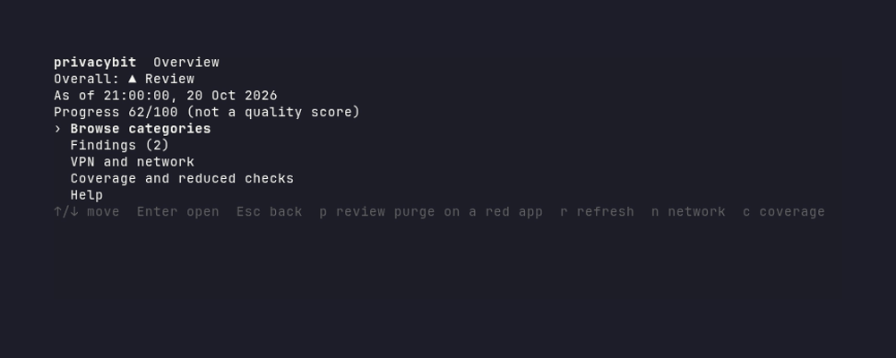
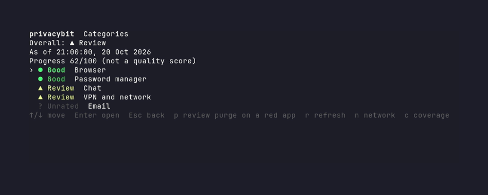

# privacybit

A privacy audit for Linux desktops. It checks installed applications and local
VPN routing state, then explains what its evidence supports and where coverage
is incomplete.

## What it checks

- **Installed applications.** Exact catalogue matches from pacman, dpkg,
  Flatpak, desktop entries, and selected executable paths, grouped by category.
- **VPN routing.** When a VPN tunnel can be verified, privacybit checks the
  IPv4 route, resolver configuration, and IPv6 route using local system state.
- **Missing protections.** Unmet catalogue expectations are findings. A check
  that cannot be judged stays `unknown`; it is not shown as a pass.

Live telemetry endpoint attribution and effective, scope-specific Flatpak
overrides are not implemented yet. Unsupported or unavailable inventory
sources are reported in coverage.

## Screenshots

These views use synthetic sample data; they do not show this machine's audit.

<p align="center">
  
</p>

<p align="center">
  
</p>

## Installation

**Requires:** Linux and Go 1.26.4 or later to build from source.

From a checkout, run the unprivileged installer:

```bash
git clone https://github.com/Nomadcxx/privacybit
cd privacybit
go run ./cmd/privacybit-install
```

It builds the CLI offline and installs it to `~/.local/bin`. The installer can
also enable the user event watcher or monthly scan timer. The first run of
`go run` may download the installer's Go modules if they are not cached.

## Usage

```bash
privacybit audit       # run an audit
privacybit tui         # browse a fresh audit
privacybit scan        # save a report for later
privacybit report      # open the saved report; press r to refresh
privacybit catalog validate
```

Audits make no network requests. VPN checks inspect local interface, routing,
and resolver state. privacybit does not send reports or usage data.

## Design

See the [design document](https://github.com/Nomadcxx/privacybit/blob/main/docs/plans/2026-10-20-privacybit-design.md).

Privacy, security, and anonymity are different properties. privacybit grades
privacy; a green result means only that the checks it ran found no meaningful
unwanted disclosure.

## License

privacybit is licensed under GPL-3.0-or-later. See [LICENSE](LICENSE).
